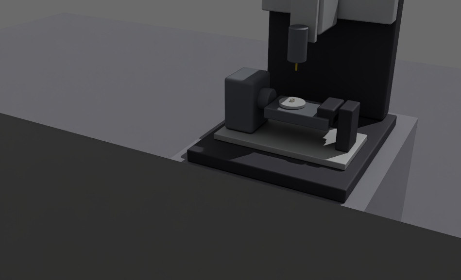
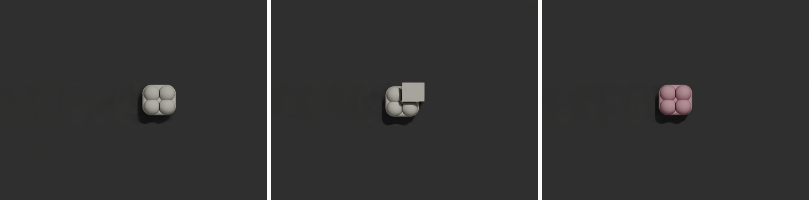
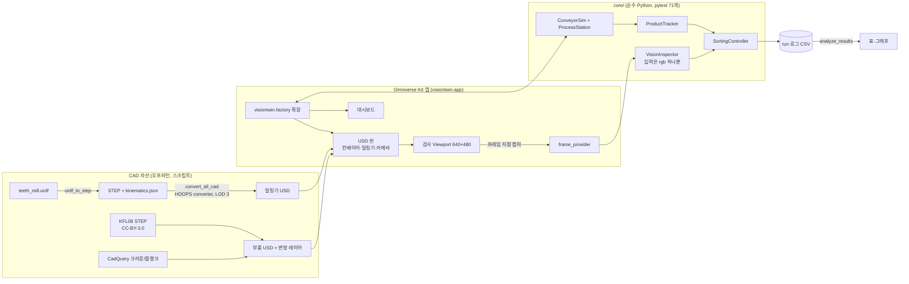
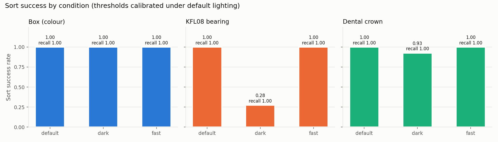
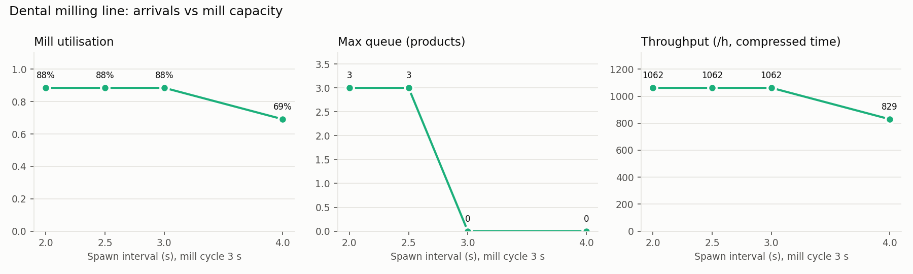

# VisionTwin — 치아 밀링 가공 라인 디지털 트윈 (Omniverse Kit × 머신비전)

> 블랭크가 컨베이어로 들어와 5축 치과용 밀링기에서 크라운으로 가공된다. 이후 카메라가 **실제 렌더 이미지**로 셰이드와 형상을 검사하고, 불량품은 **제품 ID 기준으로** 배출된다.
> 밀링기는 URDF → STEP → USD converter로 가져왔고, 라인의 공정 스테이션으로 동작하며 가동률과 대기열을 측정한다.
> 모든 수치는 저장된 run 로그(`results/`)에서 다시 계산할 수 있다. 수치는 보정하거나 꾸미지 않았다.





*검사 카메라 프레임(실험 run `crown_default`): 정상 → good, 가공 결함 → defect(shape), 셰이드 결함 → defect(color)*

**중요:** 이 프로젝트는 **시뮬레이션 기반 디지털 트윈 프로토타입**이다. 실제 현장과 동기화하거나 현장에서 검증한 디지털 트윈이 아니다. 가공 사이클 3초는 시연용 **압축 시간**이고, 밀링기 치수는 URDF에 적힌 임시값이다.

---

## 1. 문제 정의
치과 기공소의 CAD/CAM 라인에서는 블랭크를 밀링한 뒤 셰이드(색)와 형상을 검사한다. 이 프로젝트는 그 흐름을 가상 라인으로 만들어 다음을 확인한다.
1. 렌더된 카메라 이미지만으로(정답 라벨 없이) 셰이드 결함과 가공(형상) 결함을 판정할 수 있는가?
2. 판정 결과를 **바로 그 제품**에 연결해, 그 제품이 배출선에 도착했을 때만 밀어낼 수 있는가? (속도가 바뀌거나 렌더가 지연돼도)
3. 밀링기를 라인의 공정 스테이션으로 넣었을 때 가동률, 대기열, 처리량이 어떻게 변하는가?

## 2. 기능
| 영역 | 내용 |
|---|---|
| 라인 | 컨베이어, 투입(시드 고정), 밀링 스테이션(입구 대기 → 로딩 → 가공 → 언로딩), 검사선, 배출 푸셔와 bin |
| 제품 | ① 박스(색상 결함) ② **실제 CAD 부품 KFL08 베어링 유닛**(색상, 부품 누락) ③ **치아 크라운**(블랭크 → 크라운; 셰이드, 미완성 가공) |
| CAD 파이프라인 | `teeth_mill.urdf` → STEP 어셈블리(CadQuery, 필렛·챔퍼) + `kinematics.json` → USD(Omniverse CAD converter, HOOPS) → 관절 forward kinematics 재적용 |
| STEP → USD 변환 | 자산 목록(`config/cad_assets.json`)으로 일괄 변환. 프로파일(machine/product), **측정으로 고른 테셀레이션 LOD**, STEP 메타데이터, 재질. 변환마다 기록(`.convert.json`)과 **품질 리포트**(`.report.json`: STEP B-rep 대비 부피·면적·크기 오차)를 남긴다 |
| 비전 | 검사 Viewport(640×480) 프레임을 OpenCV로 판정. 색상(HSV hue 또는 Lab a*b*), 내부 밝기(누락), 기준 외곽선(`matchShapes` + 면적비) |
| 동기화 | 동기 렌더링, 고정 시뮬레이션 스텝(1/60 s), **프레임 지정 캡처**(검사선을 통과한 update 번호의 프레임만 사용, 다르면 판정을 버림) |
| 분류 | 제품 ID별 판정 → 배출선에서만 동작. 판정이 늦거나 없으면 fail-safe 배출 |
| 대시보드 | 라인(box/KFL08/crown), 시드, 제품 수, 불량률, 속도, 화면 전환(Overview/밀링기/검사 카메라), 카운터, 밀링기 상태, 대기열, 가동률, 최근 이벤트 |
| 기록 | run마다 `run.json`, `inspections.csv`, `results.csv`, `events.csv`, `summary.json`, 검사 프레임 |
| 실험 | 조건 행렬 실행(`run_experiments`), 집계/그래프(`analyze_results`), run 감사(`check_run`) |

## 3. 아키텍처



- **검사 로직과 Kit 분리:** 시뮬레이션, 추적, 검사, 분류, 지표는 Kit 없이 테스트되는 `core/`에 있다. Kit 확장은 씬, 렌더, 카메라, UI를 맡는다.
- **정답 누출 방지:** `VisionInspector.inspect(rgb)`는 이미지만 받고, 이 시그니처는 테스트로 고정했다. 정답은 tracker에서 CSV로만 복사된다.

## 4. 측정 결과 (실측)

### 개별 평가 run (seed 42, 보정은 seed 1)
| 라인 | 제품 | 분류 정답 | 결함 recall | 비고 |
|---|---|---|---|---|
| 박스 0.5 m/s / 1.5 m/s | 30 / 30 | 30/30, 30/30 | (색상 결함) | fail-safe, late, frame mismatch 모두 0 |
| KFL08 | 40 (정상 29, 색상 5, 누락 6) | 40/40 | 11/11 | TP 11, FP 0 |
| 치아 크라운 | 40 (정상 29, 셰이드 5, 가공 6) | 40/40 | 11/11 | 밀링기 가동률 91.7 % |

위 표는 Day 4~7 기록이다(뷰포트 기본 라이트 리그가 켜진 상태, CAD 변환 LOD 0). 지금 조건의 결과는 아래 Day 9 실험을 본다.

### STEP → USD 변환 품질
처음에는 변환 LOD 0(extra low)을 써서 곡면이 거친 다각형이었다. LOD 0~4를 모두 변환해 **STEP B-rep(OpenCascade)의 정확한 부피와 비교**하고 자산별 LOD를 정했다(`compare_tess_lod.ps1`, [results/cad_lod/](results/cad_lod/)).

| 자산 | 선택 LOD | 삼각형 (LOD 0 → 선택) | 부피 오차 (LOD 0 → 선택) | 이유 |
|---|---|---|---|---|
| 치아 크라운 | 3 | 608 → 16,774 | −1.68 % → −0.05 % | 근접 카메라 + 외곽선 검사 |
| KFL08 | 2 | 8,896 → 67,208 | −1.35 % → −0.005 % | LOD 3은 삼각형 3.3배인데 부피 오차 개선 없음 |
| 밀링기 | 3 | 384 → 31,040 (필렛 포함) | −0.03 % → −0.02 % | 필렛·챔퍼 곡면, 비용 작음. URDF 검증 bbox 편차 0 mm 유지 |


HOOPS의 `convertPhysicsData`는 이 STEP들에 속성을 쓰지 않아서(실측), 부피와 면적은 OpenCascade로 직접 계산했다.

### Day 9 실험 (조건 행렬)
검사기는 **default 조명의 seed 1 run에서만 보정**했다(`config/inspector*.json`, 변환 LOD를 바꾼 뒤 다시 보정). 아래 평가는 seed 42 run이고, 평가 결과를 보고 임계값을 다시 맞추지 않았다.
- 조건: `default`(기준), `dark`(조명 세기 35 %, 검사 화면 평균 밝기 −62 %), `fast`(컨베이어 1.5 m/s)
- 실험 정의: [experiments/day9.json](experiments/day9.json) · 전체 표: [results/experiments/day9/table.md](results/experiments/day9/table.md) · 13개 run 모두 `check_run` 감사 통과

| 조건 | 제품 | TP | FP | FN | TN | precision | recall | 분류 성공률 |
|---|---|---|---|---|---|---|---|---|
| box default / dark / fast | 40 | 13 | 0 | 0 | 27 | 1.00 | 1.00 | 1.00 / 1.00 / 1.00 |
| KFL08 default | 40 | 11 | 0 | 0 | 29 | 1.00 | 1.00 | 1.00 |
| **KFL08 dark** | 40 | 11 | **29** | 0 | 0 | **0.28** | 1.00 | **0.28** |
| KFL08 fast | 40 | 11 | 0 | 0 | 29 | 1.00 | 1.00 | 1.00 |
| crown default | 40 | 11 | 0 | 0 | 29 | 1.00 | 1.00 | 1.00 |
| **crown dark** | 40 | 11 | **3** | 0 | 26 | **0.79** | 1.00 | **0.93** |
| crown fast | 40 | 11 | 0 | 0 | 29 | 1.00 | 1.00 | 1.00 |



**해석 (원인은 inspections.csv의 판정 이유로 확인)**
- **결함을 놓친 경우는 없다**(모든 조건 recall 1.00). 어두워지면 정상품을 불량으로 보는 **안전 쪽 오류**가 생긴다.
- KFL08 dark: 누락 검사가 "밝은 픽셀(V ≥ 140) 비율"이라는 **절대 밝기 임계값**을 쓴다. 조명이 어두워지자 정상품의 내부 밝기가 0.00이 되어(기준 ≥ 0.161) 정상 29개가 모두 "누락"으로 판정됐다. 색(hue) 점수는 0.97~0.99로 정상이었다.
- crown dark: 밝기로 크라운을 분리하면 그림자 쪽 가장자리가 빠져, 면적비가 0.95로 허용 한계(±5 %)에 걸렸다(3건). 외곽선 거리(≤ 0.011)와 셰이드 점수(1.00)는 정상이었다.
- box: hue와 채도는 조명 세기에 거의 영향을 받지 않아 dark에서도 그대로였다.
- 속도(1.5 m/s): 동기 렌더링, 고정 스텝, 프레임 지정 캡처 덕분에 세 제품 모두 영향이 없었다(late 0, frame mismatch 0).

**치아 밀링 라인 용량** (crown 20개, 가공 사이클 3 s 압축 시간, 투입 간격만 바꿈)

| 투입 간격 | 밀링기 가동률 | 최대 대기열 | 평균 대기열 | 처리량 (/h, 압축 시간) |
|---|---|---|---|---|
| 2.0 s | 88.5 % | 3 | 1.69 | 1062 |
| 2.5 s | 88.5 % | 3 | 1.30 | 1062 |
| 3.0 s | 88.5 % | 0 | 0 | 1062 |
| 4.0 s | 69.1 % | 0 | 0 | 829 |



투입 간격이 사이클(3 s) 이하이면 **밀링기가 병목**이다. 간격을 줄여도 처리량은 늘지 않고 대기열만 길어진다. 간격이 사이클보다 길면 밀링기가 논다. 가동률이 100 %가 아닌 것은 로딩, 언로딩, 첫 제품 도착 전 시간 때문이다.

**참고: 캡처 지연(벽시계)** 은 이번 실험에서 조건별 평균 121~136 ms였다. 같은 행렬을 PC를 다른 작업과 함께 쓰면서 돌렸을 때는 130~1200 ms까지 흔들렸다(`results/experiments/day9_lod0/`). 시뮬레이션은 고정 스텝이라 두 경우 모두 판정과 분류에는 영향이 없었다(late 0, mismatch 0). 다만 이 값은 PC 부하에 따라 달라지므로 실시간 성능 지표로 쓰면 안 된다. 판정 자체(OpenCV)는 조건별 평균 1.3~8.7 ms다.

## 5. 설치와 실행

### 요구 사항 (확인한 환경)
| 항목 | 값 |
|---|---|
| OS | Windows 11 Pro (10.0.26200) |
| GPU | NVIDIA RTX 4060 8 GB, 드라이버 610.88 (RTX 필요) |
| Kit | Omniverse Kit SDK **110.4.0** (kit-app-template 브랜치 `110.4.0`, `kit_base_editor` 기반) |
| CAD 변환기 | `omni.kit.converter.hoops_core` 512.2.1 (프로파일: `config/cad_converter_options.json`, 자산별 LOD: `config/cad_assets.json`) |
| Python (Kit 밖) | 3.12, `scripts/requirements-dev.txt` (테스트·분석), `scripts/requirements-cad.txt` (CadQuery 2.8.0, usd-core 26.11) |

### 처음부터 실행
PowerShell 기준이다. 실행 정책 오류가 나면 `Set-ExecutionPolicy -Scope CurrentUser RemoteSigned`를 한 번 실행한다.

```powershell
git clone <this repo>; cd <repo>
.\scripts\build_app.ps1                      # Kit SDK와 확장 의존성 받기 + 빌드 (처음엔 오래 걸림, NVIDIA EULA 동의 필요)
python -m pip install -r scripts\requirements-dev.txt
.\scripts\test_core.ps1                      # core 단위 테스트 71개
.\scripts\launch_app.ps1                     # GUI. 대시보드에서 Product=crown → Build Scene → Start
```

### 자동 run과 재현
```powershell
.\scripts\collect_frames.ps1 -Seed 42 -Products 40 -Part crown   # run 1회 → results/runs/<id>/
.\scripts\check_run.ps1 -RunDir results\runs\<id>               # 이벤트 로그 감사
.\scripts\run_experiments.ps1 -Config experiments\day9.json     # 실험 행렬
.\scripts\analyze_results.ps1 -Experiment day9                  # table.md, fig_vision.png, fig_line.png
```

### CAD 자산 다시 만들기 (선택, 결과물은 저장소에 포함)
```powershell
.\scripts\setup_cad_env.ps1
.\scripts\urdf_to_step.ps1                                       # reference/teeth_mill.urdf → assets/cad/teeth_mill.stp
.\scripts\fetch_parts.ps1; .\scripts\make_dental_parts.ps1           # 부품 STEP 받기 / 치과 모델 STEP 만들기
.\scripts\convert_all_cad.ps1                                    # 전체 STEP → USD + 품질 리포트 + 밀링기 URDF 검증(bbox 편차 0 mm)
.\scripts\make_part_variants.ps1 -Part kfl08; .\scripts\make_part_variants.ps1 -Part crown
.\scripts\compare_tess_lod.ps1 -Stp assets\parts\raw\dental_crown.step   # (선택) LOD 0~4 비교
```
스크립트 전체 설명: [docs/topics/스크립트 목록.md](docs/topics/스크립트%20목록.md)

## 6. 저장소 구조
```text
source/apps/visiontwin.app.kit                 Kit 앱 설정 (동기 렌더링, Z-up/m, 자산 경로)
source/extensions/visiontwin.factory/          Kit 확장: extension, scene_manager, frame_provider, mill_station, dashboard
  visiontwin/factory/core/                     순수 Python: conveyor, product_tracker, vision_inspector, sorting, metrics, urdf_model ...
tests/                                         core 단위 테스트 (pytest)
scripts/                                       빌드/테스트/실행/CAD/실험 스크립트 (목적 하나당 스크립트 하나)
assets/cad, assets/parts                       밀링기 STEP/USD, 부품 STEP/USD, 출처와 라이선스
config/                                        검사기 보정값, CAD 변환 옵션
experiments/                                   실험 조건 행렬
results/                                       run 로그와 실험 결과 (프레임 이미지는 git 제외)
docs/                                          Obsidian 노트: 결정, 변경, 알게 된 점, 진행 기록
```

## 7. 한계 (Known Issues)
숨기지 않고 적는다. 각 항목의 근거는 `docs/learnings/`에 있다.
- **조명 변화에 약한 검사(실측):** KFL08 누락 검사와 크라운 면적 검사는 절대 밝기에 기대고 있어, 어두운 조명에서 정상품을 불량으로 판정한다(위 Day 9 표). 개선 방향: 제품 영역의 상대 밝기 사용, 조명별 보정, 도메인 랜덤화로 보정. 평가 데이터에 맞춰 고치지 않고 별도 seed로 다시 검증해야 한다.
- **크라운 면적 허용치가 빡빡함:** 정상 샘플 기준 ±5 %인데, 셰이드 결함 샘플의 면적비가 0.95로 한계에 있다(보정 run). 조명이나 노출이 조금만 바뀌어도 FP가 나온다.
- **시뮬레이션의 한계:** 반송은 키네마틱(물리 없음)이고, 밀링기 관절 동작은 시각용이다(G-code 없음). 가공 사이클 3 s는 압축 시간이고, 치수와 감속비는 URDF의 임시값이다.
- **렌더 조건이 단순함:** 노이즈, 블러, 렌즈 왜곡, 재질 변화가 없다. 실제 카메라에 적용하려면 실측 이미지로 다시 보정해야 한다.
- **실행 속도:** 동기 렌더링과 고정 스텝을 쓰기 때문에 GUI가 실시간보다 느리게(슬로모션처럼) 보일 수 있다. Day 9의 크라운 40개 run은 4~20분 걸렸다(PC 부하에 따라 다름).
- **HOOPS 물리량 미출력:** `convertPhysicsData`를 켜도 이 STEP들에는 `omni:hoops:physics:*` 속성이 생기지 않았다(원인 미확인). B-rep 부피와 면적은 OpenCascade로 대신 계산한다.
- **밀링기 형상:** URDF가 박스와 원통뿐이라 필렛과 챔퍼로 다듬었지만 실제 기계의 상세 형상은 아니다.
- **뷰포트 라이트 리그:** Kit은 새 stage에 기본 라이트 리그를 자동으로 넣는다. 확장이 씬을 만든 뒤 Stage Lights로 바꾸지만, GUI에서 사용자가 조명 메뉴를 바꾸면 화면이 보정 조건과 달라진다.
- **Day 4~7 기록 수치**(위 "개별 평가 run")는 라이트 리그가 켜지고 CAD 변환 LOD 0인 화면에서 측정한 값이다. 지금 화면 기준 수치는 Day 9 표다.
- 검증 환경은 Windows + RTX 4060 한 대뿐이다. Linux와 다른 GPU에서는 확인하지 않았다.

## 8. 개선 계획
- 실측 이미지로 다시 보정하고, 도메인 랜덤화(조명, 재질, 노이즈, 블러)로 검사기 강건성을 검증한다.
- 물리 기반 반송(PhysX)과 관절 드라이브, G-code 기반 가공 경로 애니메이션을 넣는다.
- 여러 스테이션(밀링 2대, 소결)과 버퍼 용량 실험으로 병목을 분석한다.
- 규칙 기반 검사기와 학습 기반 분류기(합성 데이터 학습)를 비교한다.

## 9. 라이선스와 출처
- 이 저장소의 앱/확장 골격은 NVIDIA [kit-app-template](https://github.com/NVIDIA-Omniverse/kit-app-template)(110.4.0)에서 생성했다. 원래 README는 [readme-assets/KIT_APP_TEMPLATE_README.md](readme-assets/KIT_APP_TEMPLATE_README.md), 라이선스는 [LICENSE](LICENSE)와 [PRODUCT_TERMS_OMNIVERSE](PRODUCT_TERMS_OMNIVERSE)를 따른다. Omniverse Kit SDK는 NVIDIA 라이선스로 빌드할 때 내려받는다.
- KFL08 STEP: **hasecilu**, FreeCAD-library, **CC-BY-3.0**. 변경 내용과 출처: [assets/parts/LICENSES.md](assets/parts/LICENSES.md)
- 치아 블랭크/크라운 모델은 이 프로젝트에서 CadQuery로 만들었다(`scripts/make_dental_parts.py`). 밀링기 `reference/teeth_mill.urdf`는 작성자의 ROS 2 xacro 모델을 펼친 것이다.
- 개발 기록: [docs/00_Index.md](docs/00_Index.md) (결정, 변경, 알게 된 점)
