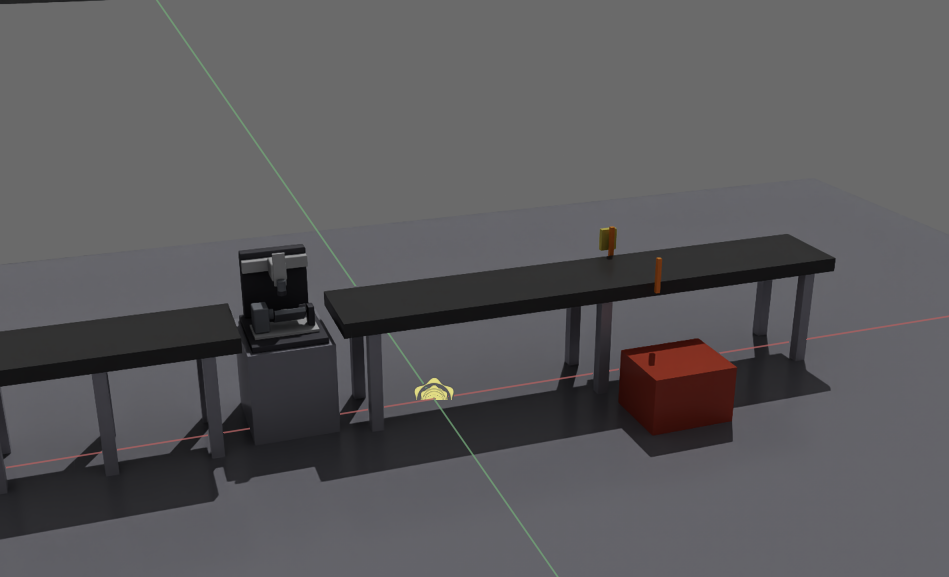
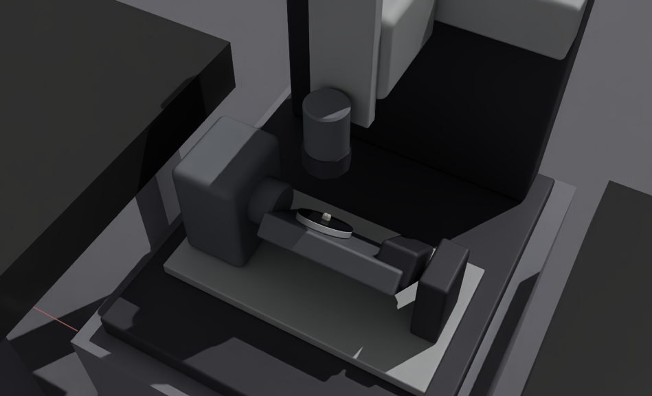
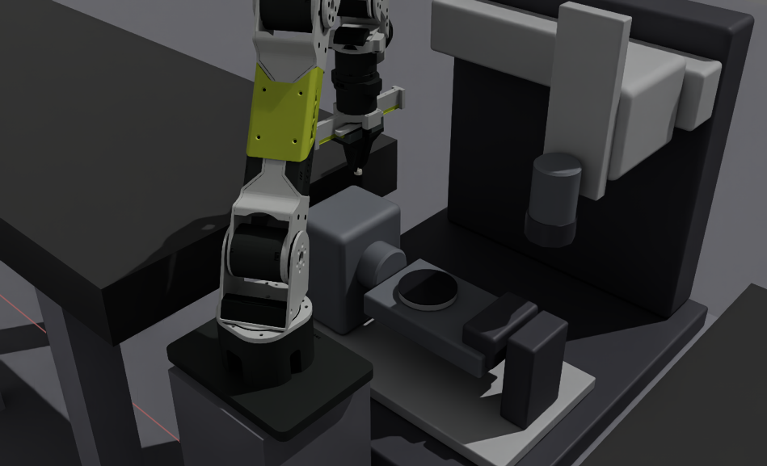
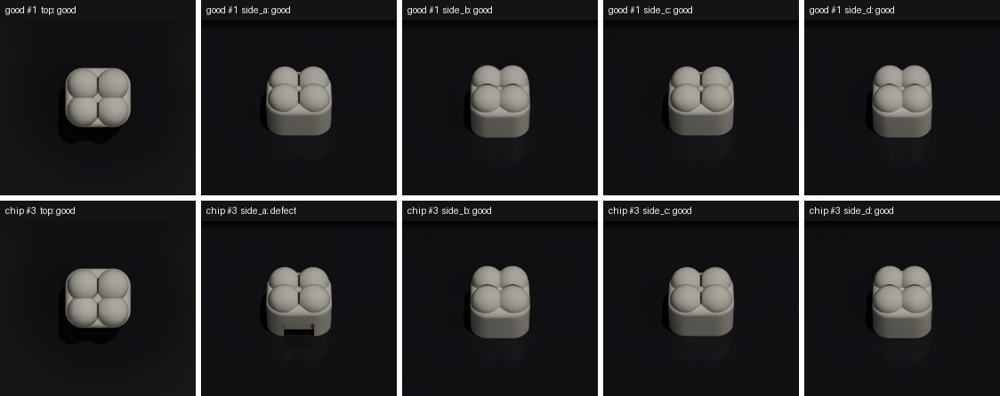
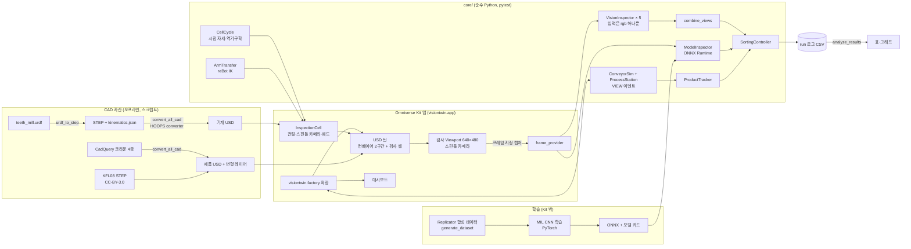
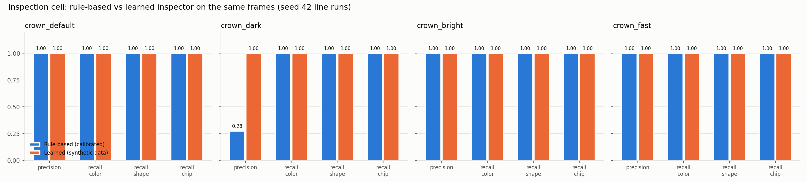
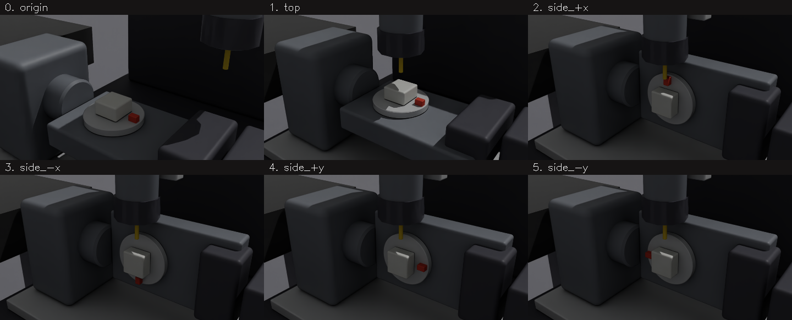
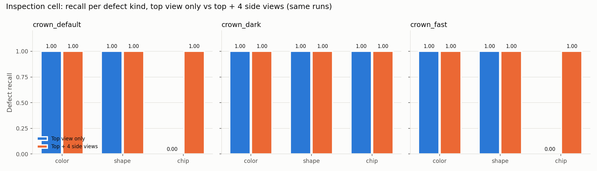
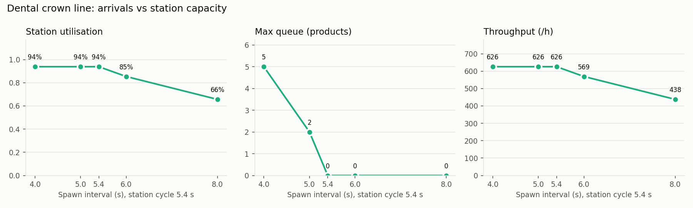
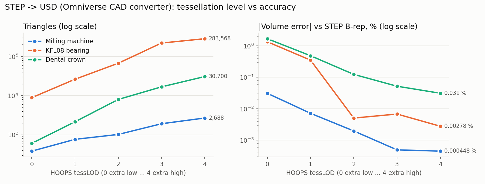

# VisionTwin — 치아 크라운 인라인 검사 라인 디지털 트윈 (Omniverse Kit × 머신비전)

> 크라운이 컨베이어를 따라 **5축 기계로 만든 인라인 검사 셀**에 들어간다. 기계는 스핀들에 공구 대신 **카메라**를 달고 있다. B/C축으로 크라운을 기울이고 돌려 윗면 1장과 옆면 4장을 찍는다. 카메라는 **실제 렌더 이미지**로 셰이드와 형상을 판정하고, 불량품은 **제품 ID 기준으로** 배출선에서 밀려난다.
> 기계는 URDF → STEP → Omniverse CAD converter(USD)로 가져왔고, 관절은 forward/inverse kinematics로 움직인다.
> 벨트와 셀 사이는 **Seeed reBot Arm(6축 + 그리퍼)**이 IK로 집어 옮긴다. 검사는 규칙 기반 검사기와, **Omniverse Replicator 합성 데이터로만 학습한 다시점 CNN**(Kit 안에서 ONNX로 추론)이 같은 프레임을 나란히 판정한다.
> 모든 수치는 저장된 run 로그(`results/`)에서 다시 계산할 수 있다. 수치는 보정하거나 꾸미지 않았다.








*스핀들 카메라 프레임(실험 run `crown_default`). 윗면만 보면 치핑(#3)은 정상품(#1)과 같아 보이고 판정도 good이다. 측면 A에서만 노치가 드러나 defect로 판정된다.*

**중요:** 이 프로젝트는 **시뮬레이션 기반 디지털 트윈 프로토타입**이다. 실제 현장과 동기화하거나 현장에서 검증한 디지털 트윈이 아니다. 기계 치수는 URDF에 적힌 임시값이고, 셀 사이클(8.2 s, 로봇 이송 포함)은 시연용 값이다. 학습 모델은 합성 데이터로만 학습했고 같은 렌더러로 평가했으므로, 실제 카메라에서의 성능 근거가 아니다.

---

## 1. 문제 정의
치과 기공소의 CAD/CAM 라인에서는 가공이 끝난 크라운의 셰이드(색)와 형상을 검사한다. 이 프로젝트는 그 검사를 가상 라인으로 만들어 다음을 확인한다.
1. 렌더된 카메라 이미지만으로(정답 라벨 없이) 셰이드 결함과 형상 결함을 판정할 수 있는가?
2. **위에서 보이지 않는 결함**(마진 치핑)을, 기계 축으로 시점을 바꿔 가며 잡을 수 있는가? 윗면 한 장과 비교해 무엇이 달라지는가?
3. 판정 결과를 **바로 그 제품**에 연결해, 그 제품이 배출선에 도착했을 때만 밀어낼 수 있는가? (속도가 바뀌거나 렌더가 지연돼도)
4. 검사 셀을 라인의 스테이션으로 넣었을 때 가동률, 대기열, 처리량이 어떻게 변하는가?
5. Omniverse 안에서 만든 **합성 데이터로 학습한 모델**이, 보정한 규칙 기반 검사기의 약점(어두운 조명)을 메울 수 있는가? 같은 프레임으로 비교한다.

## 2. 기능
| 영역 | 내용 |
|---|---|
| 라인 (크라운) | 투입 → 컨베이어 1구간 → **검사 셀**(입구 대기 → 로딩 → 시점 5개 촬영 → 언로딩) → 컨베이어 2구간 → 배출 푸셔와 bin → 출구 |
| 검사 셀 | 5축 기계(URDF) + 스핀들 카메라 + 검은 패드. 카메라를 제품 중심 위 0.11 m에 두는 **닫힌 식 역기구학**과 관절 한계 검사. 로딩·언로딩 때는 카메라를 옆으로 비킨다 |
| 이송 로봇 | **Seeed reBot Arm B601-DM**(공식 URDF + STL → USD). 6축 감쇠 최소제곱 IK(위치 + 자세), 수직 하향 파지로 크라운 방향 유지, 집기 → 플래터 → 집기 → 2구간. 경유점은 사이클을 만들 때 한 번 풀고 허용오차를 검사한다 |
| 표면별 티칭 | 대시보드 "Teach pendant": X/Y/Z/B/C 조그, 원점 + C축 블록 5면 티칭점 자동 생성(공구가 면을 수직으로 바라봄), 점 저장/이동/재생, JSON 내보내기, 점마다 각도 오차·중심 어긋남·거리·축 한계 검증 |
| 학습 검사기 | **Replicator** 합성 데이터(8,000장, 조명·셰이드·방향·카메라 랜덤화) → 다시점 MIL CNN(PyTorch) → ONNX → **Kit 안 ONNX Runtime**. 규칙 판정과 같은 프레임으로 기록하고, 배출에 쓸 판정은 `decision`(rules/model)으로 고른다 |
| 제품 | ① **치아 크라운**: 셰이드, 미완성 가공(형상), **마진 치핑(옆면에서만 보임)** ② 실제 CAD 부품 KFL08 베어링 유닛: 색상, 부품 누락 ③ 박스: 색상. ②③은 고정 카메라를 쓰는 한 줄 벨트 라인(회귀 비교용) |
| 비전 | 640×480 렌더 프레임을 OpenCV로 판정. 색(Lab a*b* 또는 HSV hue), 기준 외곽선(`matchShapes`, 면적비), **실루엣 차이**(중심을 맞춘 XOR), 내부 밝기(누락). **시점마다 따로 보정**하고 판정을 합친다 |
| 동기화 | 동기 렌더링, 고정 시뮬레이션 스텝(1/60 s), **프레임 지정 캡처**(촬영 시점 update 번호의 프레임만 사용). 셀에서는 직전 캡처와 같은 이미지가 오면 다시 찍는다 |
| 분류 | 제품 ID별 판정 → 배출선에서만 동작. 판정이 늦거나 없으면 fail-safe 배출 |
| CAD 파이프라인 | `teeth_mill.urdf` → STEP(CadQuery, 필렛·챔퍼) + `kinematics.json` → USD(HOOPS CAD converter). 자산 목록 일괄 변환, **측정으로 고른 테셀레이션 LOD**, STEP B-rep 대비 품질 리포트 |
| 대시보드 | 라인(box/KFL08/crown), 시드, 제품 수, 불량률, 속도, 화면 전환(Overview / 셀 근접 / 검사 카메라), 카운터, 셀 상태(LOADING / VIEW k/5 / UNLOADING), 대기열, 가동률 |
| 기록 | run마다 `run.json`, `inspections.csv`(시점별 행 + 합친 행), `results.csv`, `events.csv`, `summary.json`, 시점별 프레임 |
| 실험 | 조건 행렬(`run_experiments`), 집계/그래프(`analyze_results`), run 감사(`check_run`) |

## 3. 아키텍처



- **검사 로직과 Kit 분리:** 시뮬레이션, 셀 동작(역기구학 포함), 검사, 분류, 지표는 Kit 없이 테스트되는 `core/`에 있다. Kit 확장은 씬, 렌더, 카메라, UI를 맡는다.
- **정답 누출 방지:** `VisionInspector.inspect(rgb)`는 이미지만 받고, 이 시그니처는 테스트로 고정했다. 정답은 tracker에서 CSV로만 복사된다.

## 4. 측정 결과 (실측)

### 규칙 기반 vs 학습 검사기 (Day 12, 같은 run의 같은 프레임)
- 실험: [experiments/day12.json](experiments/day12.json) · 표: [results/experiments/day12/table.md](results/experiments/day12/table.md) · 9개 run 모두 `check_run` 감사 통과, late 0, frame mismatch 0
- 학습: 합성 1,600개 샘플(8,000장), 조명 0.3~1.6배. 검증 세트(합성 320개) 320/320. 평가 run(seed 42 실제 라인)은 학습에 없다. 학습 기록: [results/models/crown_mil/](results/models/crown_mil/)

| 조건 | 규칙 기반 (정상 29 / 결함 11) | 학습 모델 (같은 프레임) |
|---|---|---|
| default | FP 0, FN 0 | FP 0, FN 0 |
| **dark** (조명 0.35배, 학습 범위 안) | **FP 29**, FN 0 (precision 0.28) | **FP 0, FN 0** |
| bright (2.0배, **학습 범위 밖**) | FP 0, FN 0 | FP 0, FN 0 |
| fast (1.5 m/s) | FP 0, FN 0 | FP 0, FN 0 |
| dark + **모델이 배출 결정** | (기록만) | 분류 성공 **40/40** |



- 모델 점수의 여유가 크다. 모든 조건에서 정상품 최대 0.002, 결함 최소 0.9998이다(기준 0.5).
- 치핑 4개는 모두 **측면 A** 점수가 결정했다. 노치가 실제로 보이는 면과 같다. 같은 네트워크를 윗면 하나에만 쓰면, 합성 검증에서 치핑 recall이 0.00이었다.
- 추론 시간은 제품당(5시점) 평균 약 12.5 ms(CPU)다.
- **해석의 한계:** 학습과 평가가 같은 렌더러, 같은 형상 모델이다. 그래서 이 결과는 "합성 데이터로 조명 변화에 강건하게 만들 수 있다"는 시뮬레이션 안의 근거다. 실제 카메라 성능의 근거는 아니다. 결함 표본도 run당 11개로 작다.

### 이송 로봇이 들어간 셀 용량 (크라운 20개, 셀 사이클 8.2 s = 로딩 2.0 + 시점 3.75 + 파킹 0.45 + 언로딩 2.0)
| 투입 간격 | 셀 가동률 | 최대 대기열 | 처리량 (/h) |
|---|---|---|---|
| 6.0 s | 95.9 % | 5 | 421 |
| 8.2 s | 95.9 % | 0 | 421 |
| 10.0 s | 79.9 % | 0 | 351 |
| 12.0 s | 67.4 % | 0 | 296 |

로봇 이송(2.0 s × 2)이 들어가면서 포화 처리량이 626/h(Day 11, 포물선 이송 0.6 s)에서 421/h로 줄었다. 로봇이 셀을 기다리는 동안 다음 제품을 미리 집어 두는 파이프라이닝이 다음 개선 대상이다.

### 표면별 티칭 (Day 13): 원점 + C축 블록 5면
실제 치아 가공기에서 해 본 티칭(C축 위 네모난 블록의 윗면과 옆면 4개를 위에서 바라보는 5개 점 + 원점)을 기구학으로 다시 만들었다. 실제 티칭 값은 쓰지 않았다(`render_teach_program.ps1`, 거리 20 mm).



| 점 | X / Y / Z (mm) | B / C (°) | 각도 오차 | 중심 어긋남 | 거리 |
|---|---|---|---|---|---|
| origin | 0 / 0 / 0 | 0 / 0 | — | — | — |
| top | −119.95 / 50.98 / −34.1 | 0 / 0 | 0° | 0 mm | 20 mm |
| side 4개 | −119.95 / 68.48 / −44.1 | −90 / 90, 270, 0, 180 | 0° | 0 mm | 20 mm |

- 옆면이 위를 보려면 B를 90° 기울이고, C로 면을 고른다. 빨간 마커(C축 기준)가 점마다 90°씩 돈다.
- **10 mm로 붙이면 옆면은 도달할 수 없다.** Z가 −54.1 mm 필요한데 한계는 −49.1 mm다. 이 기계 모델의 Z 행정이 티칭 거리를 제한한다.

### 다시점 검사와 규칙 기반 검사기 (Day 11)
검사기는 **default 조명, seed 1 run에서 시점마다 보정**했다(`config/inspector_crown.json`). 아래 평가는 seed 42 run이고, 평가 결과를 보고 임계값을 다시 맞추지 않았다.
- 실험 정의: [experiments/day11.json](experiments/day11.json) · 전체 표: [results/experiments/day11/table.md](results/experiments/day11/table.md)
- 10개 run 모두 `check_run` 감사 통과, late 0, frame mismatch 0

### 윗면 한 장 vs 다섯 시점 (같은 run, 같은 제품)
`crown_default`: 크라운 40개(정상 29, 셰이드 6, 미완성 가공 1, 치핑 4). "윗면만"은 같은 run의 view 0 판정만 쓴 결과다.

| 판정에 쓴 시점 | 셰이드 recall | 형상 recall | **치핑 recall** | 전체 recall | precision |
|---|---|---|---|---|---|
| 윗면만 | 6/6 | 1/1 | **0/4** | 7/11 = 0.64 | 1.00 |
| 윗면 + 옆면 4 | 6/6 | 1/1 | **4/4** | 11/11 = 1.00 | 1.00 |



- 치핑은 보정 run에서도 윗면 실루엣 차이가 0.000이었다(위에서는 보이지 않음). 측면 A에서는 0.081이었고(정상품 최대 0.005, 기준 0.02), 그래서 측면 A에서만 잡힌다.
- 결함 표본 수가 작다(치핑 4, 미완성 가공 1). 비율보다 개수로 읽어야 한다.

### 조건별 결과
| 조건 | TP | FP | FN | TN | precision | recall | 분류 성공률 |
|---|---|---|---|---|---|---|---|
| crown default (0.5 m/s) | 11 | 0 | 0 | 29 | 1.00 | 1.00 | 1.00 |
| crown fast (1.5 m/s) | 11 | 0 | 0 | 29 | 1.00 | 1.00 | 1.00 |
| **crown dark** (조명 35 %) | 11 | **29** | 0 | 0 | **0.28** | 1.00 | **0.28** |
| box default (회귀, 고정 카메라) | 13 | 0 | 0 | 27 | 1.00 | 1.00 | 1.00 |
| KFL08 default (회귀, 고정 카메라) | 11 | 0 | 0 | 29 | 1.00 | 1.00 | 1.00 |

- **어두운 조명에 약하다(실측).** 밝기로 크라운을 분리하는데, 어두우면 가장자리가 빠져 면적비가 0.93(윗면)으로 떨어지고 외곽선 거리도 0.07(측면)로 커진다. 그래서 정상품 29개가 모두 형상 불량으로 판정됐다. 결함은 하나도 놓치지 않았다(안전 쪽 오류). 평가 데이터에 맞춰 고치지 않고 Known Issue로 남긴다. 이 조건에서 "윗면만 치핑 1.00"은 모든 제품을 불량으로 판정한 결과라 의미가 없다.
- 속도(1.5 m/s)는 셀 안에서 제품이 멈춰 있으므로 판정에 영향이 없다.
- 셀에서 직전 캡처와 같은 이미지가 온 경우가 run 4개에서 1회씩 있었고, 모두 다시 찍어 회복했다(`view_retakes`, stale 0) → [docs/learnings](docs/learnings/셀%20카메라에서%20프레임%20번호가%20맞아도%20이전%20화면이%20오는%20경우.md)
- 판정 시간(OpenCV)은 시점당 평균 약 2.6 ms다. 캡처 지연은 시점당 평균 약 145 ms(실제 시간)이고, PC 부하에 따라 달라진다.

### 검사 셀 용량, 로봇 없이 (Day 11, 크라운 20개, 셀 사이클 5.4 s, 투입 간격만 바꿈)
| 투입 간격 | 셀 가동률 | 최대 대기열 | 평균 대기열 | 처리량 (/h) |
|---|---|---|---|---|
| 4.0 s | 93.9 % | 5 | 2.28 | 626 |
| 5.0 s | 93.9 % | 2 | 0.66 | 626 |
| 5.4 s | 93.9 % | 0 | 0 | 626 |
| 6.0 s | 85.4 % | 0 | 0 | 569 |
| 8.0 s | 65.7 % | 0 | 0 | 438 |



투입 간격이 사이클(5.4 s) 이하이면 **검사 셀이 병목**이다. 처리량은 626/h에서 늘지 않고 대기열만 길어진다. 간격이 사이클보다 길면 셀이 쉰다. 시점 수가 처리량을 정한다는 뜻이기도 하다. 시점 하나(이동 0.45 s + 정지 0.3 s)를 빼면 사이클이 0.75 s 줄어든다.

### STEP → USD 변환 품질
처음에는 변환 LOD 0(extra low)을 써서 곡면이 거친 다각형이었다. LOD 0~4를 모두 변환해 **STEP B-rep(OpenCascade)의 정확한 부피와 비교**하고 자산별 LOD를 정했다(`compare_tess_lod.ps1`, [results/cad_lod/](results/cad_lod/)).

| 자산 | 선택 LOD | 삼각형 (LOD 0 → 선택) | 부피 오차 (LOD 0 → 선택) | 이유 |
|---|---|---|---|---|
| 치아 크라운 | 3 | 608 → 16,774 | −1.68 % → −0.05 % | 근접 카메라 + 실루엣 검사 |
| KFL08 | 2 | 8,896 → 67,208 | −1.35 % → −0.005 % | LOD 3은 삼각형 3.3배인데 부피 오차 개선 없음 |
| 5축 기계 | 3 | 384 → 31,040 (필렛 포함) | −0.03 % → −0.02 % | 필렛·챔퍼 곡면, 비용 작음. URDF 검증 bbox 편차 0 mm 유지 |



HOOPS의 `convertPhysicsData`는 이 STEP들에 속성을 쓰지 않아서(실측), 부피와 면적은 OpenCascade로 직접 계산했다.

### 이전 단계 기록
- Day 9 실험(밀링 라인, 고정 카메라): [results/experiments/day9/](results/experiments/day9/). 크라운 라인이 바뀌어 지금은 다시 돌릴 수 없다. box/KFL08의 조명 실험 결과(KFL08 dark FP 29)는 검사기와 고정 카메라 구성이 같아서 참고할 수 있다(당시 밀링기는 카메라 시야 밖에 있었다).
- Day 4~7 개별 run(라이트 리그가 켜지고 변환 LOD 0인 화면): 각 Day의 변경 노트(`docs/changes/`).

## 5. 설치와 실행

### 요구 사항 (확인한 환경)
| 항목 | 값 |
|---|---|
| OS | Windows 11 Pro (10.0.26200) |
| GPU | NVIDIA RTX 4060 8 GB, 드라이버 610.88 (RTX 필요) |
| Kit | Omniverse Kit SDK **110.4.0** (kit-app-template 브랜치 `110.4.0`, `kit_base_editor` 기반) |
| CAD 변환기 | `omni.kit.converter.hoops_core` 512.2.1 (프로파일: `config/cad_converter_options.json`, 자산별 LOD: `config/cad_assets.json`) |
| Python (Kit 밖) | 3.12, `scripts/requirements-dev.txt` (테스트·분석), `scripts/requirements-cad.txt` (CadQuery 2.8.0, usd-core 26.11) |

### 처음부터 실행
PowerShell 기준이다. 실행 정책 오류가 나면 `Set-ExecutionPolicy -Scope CurrentUser RemoteSigned`를 한 번 실행한다.

```powershell
git clone <this repo>; cd <repo>
.\scripts\build_app.ps1                      # Kit SDK와 확장 의존성 받기 + 빌드 (처음엔 오래 걸림, NVIDIA EULA 동의 필요)
python -m pip install -r scripts\requirements-dev.txt
.\scripts\test_core.ps1                      # core 단위 테스트
.\scripts\launch_app.ps1                     # GUI: 크라운 라인으로 열린다 → Build Scene → Start, View = Cell close-up
```

### 자동 run과 재현
```powershell
.\scripts\collect_frames.ps1 -Seed 42 -Products 40 -Part crown   # run 1회 → results/runs/<id>/
.\scripts\check_run.ps1 -RunDir results\runs\<id>               # 이벤트 로그 감사
.\scripts\inspect_frames.ps1 -RunDir results\runs\<id>          # 저장된 프레임으로 오프라인 재판정(시점별 검사기 + 합치기)
.\scripts\collect_frames.ps1 -Seed 1 -Products 30 -Part crown    # 보정 run → calibrate_inspector.ps1 -RunDir ...
.\scripts\render_teach_program.ps1                                # 표면별 티칭 6개 점 렌더 + 검증표
.\scripts\run_experiments.ps1 -Config experiments\day11.json    # 실험 행렬
.\scripts\analyze_results.ps1 -Experiment day11                 # table.md, fig_views.png, fig_line.png
```

### CAD 자산 다시 만들기 (선택, 결과물은 저장소에 포함)
```powershell
.\scripts\setup_cad_env.ps1
.\scripts\urdf_to_step.ps1                                       # reference/teeth_mill.urdf → assets/cad/teeth_mill.stp
.\scripts\fetch_parts.ps1; .\scripts\make_dental_parts.ps1           # 부품 STEP 받기 / 치과 모델 STEP 만들기
.\scripts\convert_all_cad.ps1                                    # 전체 STEP → USD + 품질 리포트 + 기계 URDF 검증(bbox 편차 0 mm)
.\scripts\make_part_variants.ps1 -Part kfl08; .\scripts\make_part_variants.ps1 -Part crown
.\scripts\compare_tess_lod.ps1 -Stp assets\parts\raw\dental_crown.step   # (선택) LOD 0~4 비교
.\scripts\fetch_robot.ps1                                        # reBot Arm URDF + 메시(고정 커밋, SHA256) → assets/robots/
.\scripts\urdf_mesh_to_usd.ps1 -Urdf assets\robots\rebot_b601_dm\Rebot_Arm_description\DM\urdf\ReBot_Arm_DM.urdf -Out assets\robots\usd\rebot_b601_dm.usd
```
로봇 USD가 없으면 같은 시간표의 포물선 이송으로 대신하므로, run 결과는 바뀌지 않는다.

### 학습 검사기 다시 만들기 (선택, 모델은 저장소에 포함: `config/models/crown_mil.onnx`)
```powershell
.\scripts\setup_ml_env.ps1                                       # torch(CUDA), onnx
.\scripts\generate_dataset.ps1 -Out datasets\crown_sdg_v1 -Samples 1600   # Replicator 합성 데이터(약 20분, 0.8 GB)
.\scripts\train_inspector_model.ps1 -Dataset datasets\crown_sdg_v1      # MIL CNN → ONNX + 모델 카드(약 3분, RTX 4060)
.\scripts\run_experiments.ps1 -Config experiments\day12.json; .\scripts\analyze_results.ps1 -Experiment day12
```
스크립트 전체 설명: [docs/topics/스크립트 목록.md](docs/topics/스크립트%20목록.md)

## 6. 저장소 구조
```text
source/apps/visiontwin.app.kit                 Kit 앱 설정 (동기 렌더링, Z-up/m, 자산 경로, 기본 제품 crown)
source/extensions/visiontwin.factory/          Kit 확장: extension, scene_manager, inspection_cell, frame_provider, dashboard
  visiontwin/factory/core/                     순수 Python: conveyor, cell_cycle, product_tracker, vision_inspector, sorting, metrics, urdf_model ...
tests/                                         core 단위 테스트 (pytest)
scripts/                                       빌드/테스트/실행/CAD/실험 스크립트 (목적 하나당 스크립트 하나)
assets/cad, assets/parts                       기계 STEP/USD, 제품 STEP/USD, 출처와 라이선스
config/                                        검사기 보정값(크라운은 시점별), CAD 변환 옵션, 자산 목록
experiments/                                   실험 조건 행렬
results/                                       run 로그와 실험 결과 (프레임 이미지는 git 제외)
docs/                                          Obsidian 노트: 결정, 변경, 알게 된 점, 진행 기록
```

## 7. 한계 (Known Issues)
숨기지 않고 적는다. 각 항목의 근거는 `docs/learnings/`에 있다.
- **조명 변화에 약한 검사(실측):** 크라운의 밝기 기반 분리와 KFL08의 누락 검사(절대 밝기 V ≥ 140)는 어두운 조명에서 정상품을 불량으로 판정한다(crown dark FP 29/29, Day 9 KFL08 dark FP 29/29). 개선 방향: 상대 밝기, 조명별 보정, 도메인 랜덤화. 고친다면 평가 데이터가 아닌 새 seed로 다시 검증해야 한다.
- **학습 모델의 근거 범위:** 합성 데이터로만 학습하고 같은 렌더러로 평가했다. 실제 카메라에서는 노이즈, 반사, 재질 차이 때문에 다시 학습(실측 이미지 + 합성)이 필요하다. 학습 조명 범위(0.3~1.6배) 밖인 bright(2.0배)에서도 맞혔지만, 조건 하나뿐이다.
- **결함 표본이 작다:** 평가 run 하나에 치핑 4개, 미완성 가공 1개뿐이다. 결함 종류별 recall은 개수로 읽어야 한다.
- **치핑 방향이 고정:** 모든 크라운이 같은 방향으로 놓여서 치핑은 항상 측면 A에 보인다. 옆면 4개를 모두 찍으므로 방향이 달라도 보이는 시점은 있지만, 무작위 방향은 실험하지 않았다(윗면 외곽선 검사가 회전에 민감함).
- **셀 캡처의 이전 화면:** 프레임 번호가 맞는데도 직전 화면이 오는 경우가 있다(Day 11 실험 캡처 1,100장 중 4번). 다시 찍어서 모두 회복했지만 원인은 확인하지 못했다.
- **시뮬레이션의 한계:** 반송과 픽앤플레이스는 키네마틱이다(물리, 충돌 검사 없음). 로봇과 기계의 관절 동작은 시각용이고, 로봇 궤적은 관절 공간 보간이라 충돌 회피를 하지 않는다. 치수와 사이클은 임시값이다.
- **렌더 조건이 단순함:** 노이즈, 블러, 렌즈 왜곡, 재질 변화가 없다. 실제 카메라에 적용하려면 실측 이미지로 다시 보정해야 한다.
- **실행 속도:** 동기 렌더링과 고정 스텝을 쓰기 때문에 GUI가 실시간보다 느리게 보일 수 있다. 크라운 40개 run은 약 5분이 걸렸다.
- **HOOPS 물리량 미출력:** `convertPhysicsData`를 켜도 이 STEP들에는 `omni:hoops:physics:*` 속성이 생기지 않았다(원인 미확인).
- **기계 형상:** URDF가 박스와 원통뿐이라 필렛과 챔퍼로 다듬었지만 실제 기계의 상세 형상은 아니다.
- **뷰포트 라이트 리그:** Kit은 새 stage에 기본 라이트 리그를 넣는다. 확장이 Stage Lights로 바꾸지만, GUI에서 조명 메뉴를 바꾸면 화면이 보정 조건과 달라진다.
- 검증 환경은 Windows + RTX 4060 한 대뿐이다.

## 8. 개선 계획
- 상대 밝기 기반 분리와 도메인 랜덤화(조명, 재질, 노이즈, 블러)로 조명 강건성을 확보하고, 새 seed로 다시 평가한다.
- 시점 수와 각도를 최적화한다(처리량과 검출률의 균형). 결함 방향을 무작위로 바꾸는 실험을 한다.
- 벨트↔플래터 이송에 로봇 팔(URDF)을 넣고, 물리 기반 반송(PhysX)으로 바꾼다.
- 규칙 기반 검사기와 학습 기반 분류기(합성 데이터 학습)를 비교한다.

## 9. 라이선스와 출처
- 이 저장소의 앱/확장 골격은 NVIDIA [kit-app-template](https://github.com/NVIDIA-Omniverse/kit-app-template)(110.4.0)에서 생성했다. 원래 README는 [readme-assets/KIT_APP_TEMPLATE_README.md](readme-assets/KIT_APP_TEMPLATE_README.md), 라이선스는 [LICENSE](LICENSE)와 [PRODUCT_TERMS_OMNIVERSE](PRODUCT_TERMS_OMNIVERSE)를 따른다. Omniverse Kit SDK는 NVIDIA 라이선스로 빌드할 때 내려받는다.
- KFL08 STEP: **hasecilu**, FreeCAD-library, **CC-BY-3.0**. 변경 내용과 출처: [assets/parts/LICENSES.md](assets/parts/LICENSES.md)
- 치아 크라운 모델(정상, 미완성, 치핑)은 이 프로젝트에서 CadQuery로 만들었다(`scripts/make_dental_parts.py`). 5축 기계 `reference/teeth_mill.urdf`는 작성자의 ROS 2 xacro 모델을 펼친 것이다.
- 개발 기록: [docs/00_Index.md](docs/00_Index.md) (결정, 변경, 알게 된 점)
